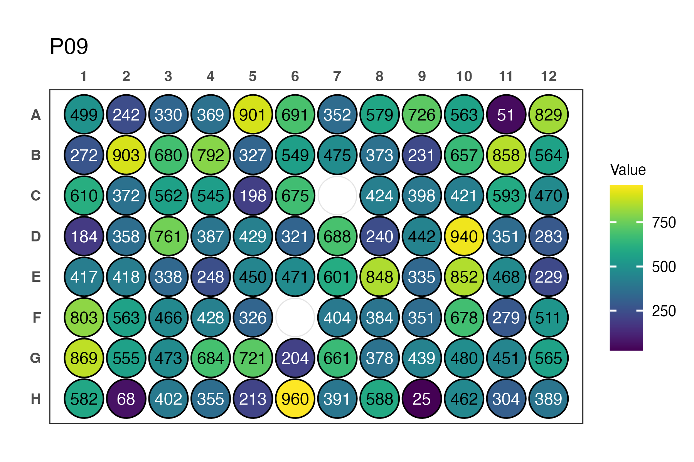
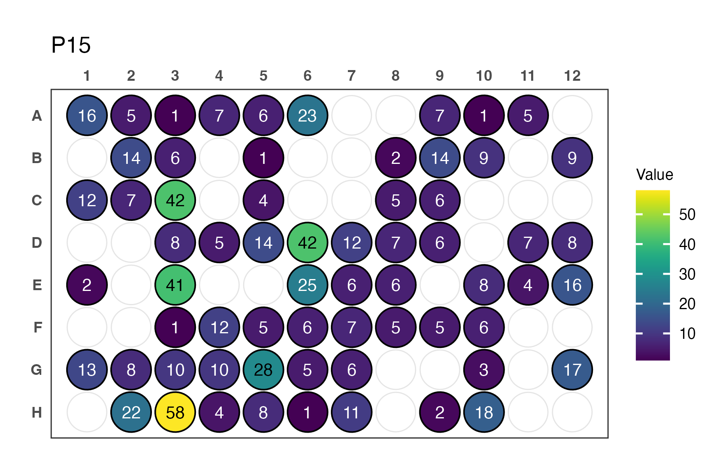

# clonality

`clonality` is an R package for assigning B cell and T cell receptor clonotypes from repertoire sequencing data.
It grew around practical analysis needs for IMGT HighV-QUEST outputs, 10x Genomics Cell Ranger V(D)J annotations, and plate-based repertoire experiments where clone calling and plate quality assessment need to live in the same workflow.

The package currently helps with four broad tasks:

- clonotype assignment from IMGT-style tables
- clonotype assignment from 10x Genomics V(D)J contig annotations
- plate-level contig inspection and QC
- downstream integration with Seurat and immunarch-friendly formats
- interactive Circos-style clone sharing visualization in a browser

## Installation

```r
devtools::install_github("victoraLab/clonality")
```

## What The Package Covers

`clonality` supports:

- IMGT summary and junction outputs
- 10x Genomics Cell Ranger V(D)J annotations, including v3, v7, and v9-style bundled example data
- BCR, TCR, and gamma-delta TCR use cases
- exact or fuzzy grouping based on V gene, J gene, and CDR3 similarity

At a high level, the package separates into a few complementary layers:

1. Read and standardize repertoire inputs.
2. Assign clonotypes from sequence features.
3. Post-process plate-based outputs for QC and visualization.
4. Export or attach results for downstream single-cell analysis.

## Main Workflows

### 1. IMGT-style clonotype assignment

Use `clonality()` when your starting point is an IMGT-derived table or a compatible data frame containing V, J, and CDR3 information.

```r
library(clonality)

head(tra)

tra_out <- clonality(
  data = tra,
  output = "tra.output",
  vgene_col = "V_GENE_and_allele",
  jgene_col = "J_GENE_and_allele"
)
```

Typical inputs for this workflow are:

- a data frame already loaded in R
- a parsed IMGT table
- package example datasets such as `tra`, `trb`, `IMGT_BCR_Summary_File`, and `IMGT_TCR_Summary_File`

### 2. 10x Genomics clonotype assignment

Use `tenx()` when your starting point is a Cell Ranger V(D)J contig annotation table.
This wrapper handles filtering, grouping by barcode, and delegating clone definition to the package clonality logic.

```r
head(Cellranger9_BCR1)

tenx_out <- tenx(
  data = Cellranger9_BCR1,
  method = "unique_paired",
  cell = "B",
  only_productive = TRUE,
  only_true_cells = TRUE,
  cellranger_version = 9
)
```

Available clonotype strategies include:

- `unique_paired`
- `sticky_ends`
- `unique_all`

Supported cell modes include:

- `cell = "B"`
- `cell = "T"`
- `cell = "Tgd"`

### 3. Plate-based QC and visualization

For plate sequencing projects, the package extends beyond clone calling to help identify real contigs, background signals, collapsed wells, and overall plate performance.

```r
output <- clonality(
  data = IMGT_BCR_Summary_File,
  cdr3_col = "DNA_Junction",
  cell = "B",
  mismatch = 90
)

analyzed_contigs <- analyze_well_contigs(
  output,
  barcode_format = "WELL_PLATE"
)

plate_metadata <- extract_plate_metadata(
  df = analyzed_contigs$real_contigs_input,
  barcode_format = "WELL_PLATE"
)

plate_quality <- evaluate_plate_quality(analyzed_contigs)

plot_plate_contig_depth(plate_metadata, plate_id = "P09")
```



The same pattern works for TCR plate projects:

```r
output <- clonality(
  data = IMGT_TCR_Summary_File,
  cdr3_col = "DNA_Junction",
  cell = "T"
)

analyzed_contigs <- analyze_well_contigs(
  output,
  barcode_format = "PLATE_WELL"
)

plate_metadata <- extract_plate_metadata(
  df = analyzed_contigs$real_contigs_input,
  barcode_format = "PLATE_WELL"
)

plate_quality <- evaluate_plate_quality(analyzed_contigs)

plot_plate_contig_depth(plate_metadata, plate_id = "P01")
```



### 4. Single-cell downstream integration

When clone annotations need to move into single-cell workflows, `clonality` provides direct support for Seurat metadata integration and immunarch-oriented export.

```r
seu <- add_seurat_metadata(
  seu = my_seurat_object,
  clonal.list = ls(pattern = "^Clonal"),
  cell = "T",
  sticky = TRUE,
  overwrite = TRUE
)
```

```r
imm <- gen_immunarch(
  seu,
  proportion = "rm.na",
  sample_column = "Conditions"
)
```

### 5. Interactive Circos viewer

The package also bundles a lightweight D3 viewer for clone sharing across
conditions or tissues.

Open the viewer with:

```r
clonality::open_circos_viewer()
```

If your data are already in a wide clone-by-group table:

```r
wide_df <- data.frame(
  Clone_ID = c("1.1", "2.1", "6.1"),
  M1LP_PC = c(2, 3, 3),
  M1PP_GC = c(11, 0, 0),
  M2LP_PC = c(0, 0, 1)
)

viewer_df <- clonality::circos_viewer_wide_to_long(
  wide_df,
  clone_col = "Clone_ID"
)
```

If your table already has one row per cell or per contig plus a grouping
column:

```r
results$condition <- sample(
  c("M1LP_PC", "M1PP_GC", "M2LP_PC"),
  nrow(results),
  replace = TRUE
)

viewer_df <- clonality::circos_viewer_input(
  data = results,
  clonotype_col = "clonality",
  group_col = "condition"
)
```

Then paste `viewer_df` into the viewer using `Clonotype table` mode.

## Function Map

One useful way to navigate the package is by grouping functions according to the step of the analysis they support.

### Core clone assignment

| Function | Purpose |
| --- | --- |
| `clonality()` | Main clone assignment engine for IMGT-style or compatible repertoire tables |
| `cluster_duplicates_by_cdr3()` | Subclusters duplicated V-J-CDR3-length bins by CDR3 similarity |
| `assign_unique_ids()` | Assigns unique clone IDs when rows do not belong to duplicated bins |
| `simplify_genenames()` | Simplifies gene naming to make grouping more robust |

### 10x Genomics processing

| Function | Purpose |
| --- | --- |
| `tenx()` | End-to-end 10x V(D)J clonotype annotation wrapper |
| `assigntenx()` | Internal-style lower-level assignment helper for 10x workflows |
| `cellranger_version_parser()` | Detects or validates Cell Ranger annotation schema version |
| `extract_and_unite()` | Pulls chain-specific columns and optionally collapses them row-wise |

### Input parsing and project ingestion

| Function | Purpose |
| --- | --- |
| `parse_general()` | Reads general tabular inputs such as `.csv`, `.txt`, and `.xlsx` |
| `parse_imgt()` | Parses IMGT `1_Summary.txt` and `6_Junction.txt` outputs into a merged table |
| `filter_sequences_imgt()` | Filters IMGT-derived sequences before downstream processing |
| `process_imgt_projects()` | Runs multiple IMGT project folders in parallel and combines outputs |

### Plate-level analysis and QC

| Function | Purpose |
| --- | --- |
| `analyze_well_contigs()` | Classifies well contigs into real and background categories |
| `extract_plate_metadata()` | Parses plate, well, contig, and depth metadata from cell IDs |
| `evaluate_plate_quality()` | Summarizes plate efficiency and collapse metrics |
| `plot_plate_contig_depth()` | Displays well-level contig depth for one plate |
| `plot_multiple_plates()` | Arranges several plate-level depth plots together |

### Downstream integration

| Function | Purpose |
| --- | --- |
| `add_seurat_metadata()` | Writes clonality annotations into a Seurat object |
| `gen_immunarch()` | Builds an immunarch-compatible structure from Seurat metadata |

## Example Pipelines

### IMGT BCR example

```r
output <- clonality(
  data = IMGT_BCR_Summary_File,
  cdr3_col = "DNA_Junction",
  cell = "B",
  mismatch = 90
)
```

### IMGT TCR example

```r
output <- clonality(
  data = IMGT_TCR_Summary_File,
  cdr3_col = "DNA_Junction",
  cell = "T"
)
```

### Cell Ranger v7 BCR example

```r
head(Cellranger7_BCR1)

tenx_out <- tenx(
  data = Cellranger7_BCR1,
  method = "unique_paired",
  cell = "B",
  only_productive = TRUE,
  only_true_cells = TRUE,
  clonality_input = c(mismatch = 10),
  cellranger_version = 7
)
```

### Cell Ranger v3 TCR example

```r
head(Cellranger3_TCR)

tenx_out <- tenx(
  data = Cellranger3_TCR,
  method = "sticky_ends",
  cell = "T",
  only_productive = TRUE,
  cellranger_version = 3
)
```

### Multi-project IMGT processing

```r
results <- process_imgt_projects(
  project_paths = c("project_1", "project_2", "project_3"),
  cell_type = "B",
  mismatch = 10
)
```

## Included Example Data

The package ships with example objects that make it easier to test workflows and document expected inputs:

| Dataset | Description |
| --- | --- |
| `tra` | Small IMGT TCR alpha dataset |
| `trb` | Small IMGT TCR beta dataset |
| `IMGT_BCR_Summary_File` | Processed IMGT HighV-QUEST BCR summary table |
| `IMGT_TCR_Summary_File` | Processed IMGT HighV-QUEST TCR summary table |
| `Cellranger3_TCR` | Example 10x Cell Ranger v3 TCR contig annotations |
| `Cellranger7_BCR1`, `Cellranger7_BCR2` | Example 10x Cell Ranger v7 BCR contig annotations |
| `Cellranger9_BCR1` | Example 10x Cell Ranger v9 BCR contig annotations |
| `Cellranger7_TCRgd` | Example 10x Cell Ranger v7 gamma-delta TCR contig annotations |
| `chain_classes` | Supported chain class definitions used in 10x workflows |

## Suggested Reading Order

If you are new to the package, a good progression is:

1. Start with `clonality()` if your data already looks IMGT-like.
2. Use `tenx()` if your input comes from Cell Ranger V(D)J output.
3. Add `analyze_well_contigs()`, `extract_plate_metadata()`, and `evaluate_plate_quality()` for plate-based projects.
4. Finish with `add_seurat_metadata()` or `gen_immunarch()` if you need downstream single-cell integration.

## Current Focus Of The Package

The package reflects several years of iterative development around real experimental use cases.
That is a strength, because it contains practical workflows, but it also means some parts of the interface are richer than the README previously suggested.
This document is intended to make the current surface area easier to discover before the next pass on code organization, consistency, and efficiency.
